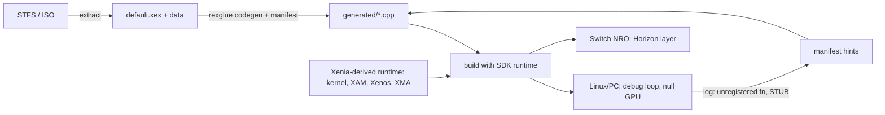

# Xbox 360 static recompilation (ReXGlue / XenonRecomp → Switch and others)

PowerPC code of `default.xex` is translated to C++ (one function per guest function, `ctx` + `base` arguments).
A runtime supplies kernel, GPU, audio and input. No emulator, no JIT.
Research date: 2026-10-22. Everything below is tagged by evidence in the references: [CODE] source read, [DOC] doc only, [GUESS] inference.

## First move when a port is slow (read this before anything else)

1. Run `scripts/lint_manifest.sh <manifest> [generated_dir]`. Unset codegen flags and a missing `[rexcrt]` are the cheap wins.
2. Sample the guest main thread (PC sampler with counts). Waiting in `svc` stubs = a wait; one tiny hot function = a spin; flat = healthy.
3. Read `references/performance.md` section 0 and section 8. Top suspects, in order: (a) stock `WAIT_REG_MEM` blind `Sleep` and missing fence wake while the guest spins on the fence; (b) host threads without Horizon priorities (guest spinners starve the main thread); (c) log/SD writes on a hot thread; (d) unset `*_as_local`, `skip_msr`, `[rexcrt]`; (e) `mftb`/lock spins; (f) the renderer last.

## References (read what the task needs)

| File | Content |
|---|---|
| [references/pipeline.md](../../../docs/xbox360-porting/pipeline.md) | XEX → codegen: toolchains, manifest keys, hard problems and fixes, instruction model, tools |
| [references/performance.md](../../../docs/xbox360-porting/performance.md) | Decision tree, codegen flags, rexcrt, spins/waits/time, host bugs, memory cost, GPU CPU cost, ports' measured results |
| [references/runtime-kernel.md](../../../docs/xbox360-porting/runtime-kernel.md) | XEX/STFS/TU, kernel exports, time, CPU semantics, audio/XMA, input, process lessons |
| [references/gpu.md](../../../docs/xbox360-porting/gpu.md) | Emulate vs native renderer, shaders, formats, EDRAM/resolve, 2D checklist, shared-memory tracking |
| [references/switch-horizon.md](../../../docs/xbox360-porting/switch-horizon.md) | Prior-art Switch ports, memory model (alias recipe vs our fold), threads/priorities, time, SD, exit, NVK vs deko3d |
| [references/deko3d-and-field-lessons.md](../../../docs/xbox360-porting/deko3d-and-field-lessons.md) | Field lessons from Castlevania, Hard Corps and Guardian Heroes on Switch: why deko3d, Xenos translation bugs, memory, priorities, workflow, legal |
| [references/titles.md](../../../docs/xbox360-porting/titles.md) | Decision list for Castlevania HoD, Guardian Heroes 2011, Contra Uprising (= Hard Corps: Uprising) |
| [references/projects.md](../../../docs/xbox360-porting/projects.md) | Catalog of repos and the honest checked / not checked list |
| `scripts/lint_manifest.sh` | Flags the perf settings of a manifest and counts hot macros in generated code |

## Procedure

Work in phases; each ends with a gate. Write findings in the port's own CLAUDE.md (symptom, cause, file, fix, how found, date).

1. **Facts.** Title ID, content type, XEX encryption/compression, TU, image base/size, modules (`XexLoadImage` DLLs), imports. Gate: `default.xex` loads and codegen reads it.
2. **Codegen.** `rexglue init/codegen`; fix Validate; add `noreturn`, function ends, setjmp/longjmp, pointer scans (stuntdouble patches). Gate: 0 `REX_FATAL` reached at boot, builds.
3. **Boot on Linux/PC** with the SDK's Xenos plugin and with the null GPU backend. Gate: title screen, menus, one level; log has no unregistered calls.
4. **Perf flags** (performance.md §1-2) one at a time, with a boot test after each.
5. **Switch layer**: memory window, exception handler, threads and priorities, clock, fibers, log writer thread, exit. Gate: Eden null-GPU run passes (swaps grow, clean exit).
6. **Console**: profiler first (counts + link map), then waits/priorities/log/SD, then renderer.
7. **Game features**: input, audio (XMA worker), saves, DLC, TU, multiplayer.
8. **Ship**: installer from the user's own files, SHA-256 pinned inputs, no game data in the repo.

## Rules

- Never commit game data, XEX, extracted data or generated code. Keep `generated/`, `game/`, builds out of git.
- Never hand-edit generated files; use midasm hooks, `REX_NATIVE_HOOK`, weak overrides, or the manifest.
- Declare setjmp/longjmp before the first run. Pin one build (TU, region).
- GPL-3.0 ports (sa2-nx family, UnleashedRecomp, Marathon-NX): read for ideas; do not copy files into a non-GPL tree. ReXGlue is BSD-3; stuntdouble is MIT; check each patch set.
- Measure first; one change per test; compare at equal clocks; report numbers with the build version.
- Clone repos into a SHORT path (Windows MAX_PATH).
- Test runs must not take over the desktop (muted, minimized). One Linux test at a time.
- Ask before commits or pushes; do not touch the console unless the user asks.

## Checked / not checked (summary; full list in references/projects.md)

Read code: hedge-dev/XenonRecomp (macros, config), UnleashedRecomp (toml, memory, flags), rexglue-sdk v0.10.0 (codegen config/builders, pch template, clock, command processor waits, crt), NocturneRecomp (manifest, rexcrt, hooks), stuntdouble-reignition, Hard Corps: Uprising (manifest, patch table), sa2-nx / usf4-nx / futari-nx / Marathon-NX / Unleashed-NX (through delegated readers, with file:line).
README or docs only: XenosRecomp, Xerenge, Dead Rising 2 CZ, speedbreaker details, CrownPark fork (doc, not code), the strategy guide.
Not checked: Xenia source, any real XEXP delta format, Guardian Heroes (no port found), whether the sa2 alias recipe works on our console, every performance number (they are the authors' claims; nothing was built or run).
